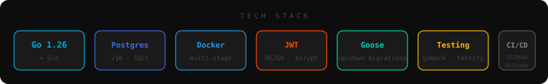

<div align="center">
  
  <h1>Bar 108 API</h1>
  <p><strong>Restaurant ordering backend in Go</strong></p>
  <p>
    <a href="https://github.com/bytepharaoh/Bar108/actions/workflows/ci.yml"></a>
    
    
    
    
    <a href="LICENSE"></a>
  </p>
  <p><a href="README.md">English</a> · <a href="README.ru.md">Русский</a></p>
</div>

Bar 108 is a Go HTTP API for a restaurant ordering workflow. It supports customer accounts, a menu, orders, status history, promotions, and admin operations. This repository contains the backend and deployment configuration. It does not contain a customer app, payment integration, courier app, or live location tracking. “Tracking” means reading recorded order statuses over HTTP.

The code runs locally or with Docker Compose. A separate Compose file is a starting point for deployment on one server. A green CI run confirms the checked code builds and passes its tests; it does not confirm that a particular server, backup schedule, or alert receiver is configured.

## Engineering highlights

| 33 HTTP routes | 42 test functions + 36 subtests | 12 CI verification steps | 6 production services |
| :---: | :---: | :---: | :---: |
| Auth, menu, orders, users, and couriers | Unit, handler, security, and PostgreSQL integration coverage | Format, vet, lint, race, build, container, and configuration checks | API, PostgreSQL, Redis, Caddy, Prometheus, and Alertmanager |

- Implements a six-stage order lifecycle with SQL-guarded transitions so concurrent updates cannot both apply the same state change.
- Uses four versioned Goose migrations and sqlc-generated, type-safe PostgreSQL access instead of handwritten row mapping.
- Revalidates account status and role on authenticated requests, supports Redis-backed token revocation, and fails protected operations closed when the security dependency is unavailable.
- Packages HTTPS termination, health checks, metrics, alert rules, secret files, database backup, and restore verification for a reproducible single-server deployment.

These figures describe the current repository and are intended to be auditable from the source and CI workflow; they are not synthetic traffic or latency claims.


## Architecture


```text
HTTP client → Gin handlers → services → repositories → PostgreSQL
                  │                │
                  └── JWT auth     └── Redis for revocation, rate limits, and cache
```

Handlers parse requests and check resource ownership. Services validate business rules. Repositories use sqlc generated queries and transactions for multi-step writes. Goose applies migrations at application startup. PostgreSQL is the source of truth for accounts and orders. Authenticated requests check the current account state in PostgreSQL, so deactivation and role changes take effect on the next request.

The main tools are Go 1.26.11, Gin, PostgreSQL 16, Redis 7, sqlc, Goose, JWT with bcrypt, Docker Compose, Caddy, Prometheus, and Alertmanager. The production Compose setup targets one host; it is not a high availability design.

## Technology stack



Redis supports token revocation, rate limiting, and caching. Caddy terminates HTTPS, while Prometheus and Alertmanager provide metrics and alert routing. These operational components extend the core application stack shown above.

## Run locally

Requirements: Go 1.26.11 or newer, Docker with Compose, and `make` for the commands below.

```bash
git clone https://github.com/bytepharaoh/Bar108.git
cd Bar108
cp .env.example .env
```

Edit `.env` before starting. Its database password and JWT secret are development examples. Give `JWT_SECRET` a fresh random value, for example with `openssl rand -hex 32`. Keep `.env` out of Git.

```bash
make db-up       # start PostgreSQL and Redis
make run         # connect, apply Goose migrations, start HTTP on port 8080
```

In another terminal, check `curl http://localhost:8080/ping`. `GET /ready` checks PostgreSQL and Redis and returns 503 when either is unavailable. To run the whole development stack in containers, use `docker compose up -d --build` after creating `.env`, then `docker compose logs -f app`. The development Compose file binds database and Redis ports to localhost. Stop containers with `docker compose down`; named data volumes remain.

Example request sequence:

```bash
curl -X POST http://localhost:8080/auth/register \
  -H 'Content-Type: application/json' \
  -d '{"name":"Ahmed","phone":"+79001234567","email":"you@example.com","password":"change-this-password"}'

# Copy the token from the response into your shell:
TOKEN='paste-token-here'
curl -X POST http://localhost:8080/orders \
  -H "Authorization: Bearer $TOKEN" \
  -H 'Content-Type: application/json' \
  -d '{"items":[{"menu_item_id":1,"quantity":2}]}'
```

The server takes the order's user ID from the token. Menu IDs 1–5 are created by the seed migration for a fresh database; check `GET /menu` when using existing data.

## Authentication and order flow


## API overview

All endpoints return JSON. Protected endpoints require `Authorization: Bearer <token>`. Customers can access their own profiles and orders; admins can manage restaurant data. There is no public admin registration route: provision the initial admin role through a controlled database operation.

| Access | Methods and paths | Purpose |
| --- | --- | --- |
| Public | `GET /ping`, `GET /menu`, `GET /menu/:id`, `GET /categories` | Liveness and menu reads |
| Public | `POST /auth/register`, `POST /auth/login` | Account creation and login; rate limited per client IP |
| Signed in | `POST /auth/logout` | Revoke the current token in Redis |
| Signed in | `POST /orders`, `GET /orders/:id`, `GET /orders/:id/items`, `GET /orders/:id/track`, `PATCH /orders/:id/cancel` | Place, inspect, track, or cancel an owned order |
| Signed in | `GET /users/:id`, `PUT /users/:id`, `GET /users/:id/orders` | Own profile and orders; admins may inspect other users |
| Admin | `GET /orders`, `GET /orders/pending`, `PATCH /orders/:id/status`, `PATCH /orders/:id/courier` | Order operations |
| Admin | `POST /menu`, `PUT /menu/:id`, `DELETE /menu/:id` | Menu management |
| Admin | `GET /users`, `GET /users/active`, `PATCH /users/:id/activate`, `PATCH /users/:id/deactivate`, `PATCH /users/:id/bonus` | Account administration and manual bonus adjustment |
| Admin | `GET /couriers`, `GET /couriers/available`, `GET /couriers/:id`, `PATCH /couriers/:id/status` | Courier records and availability |
| Internal | `GET /ready`, `GET /metrics` | Dependency readiness and metrics; blocked by public Caddy route |

Order states progress through `pending → confirmed → preparing → ready → out_for_delivery → delivered`; cancellation is possible before a terminal state. Updates are guarded in SQL so competing writes cannot both apply the same transition. Order prices use decimal arithmetic and stored menu prices; item prices are copied into the order. Promotions have usage and expiry checks. Bonus points currently have a manual admin endpoint; automatic earning and redemption are not implemented.

## Tests and development

```bash
go test -race -timeout 60s ./...
go vet ./...
make lint           # requires golangci-lint
make sqlc           # requires sqlc only when changing SQL queries
```

Handler and service tests use mocks. The repository integration test runs against PostgreSQL when `BAR108_TEST_DATABASE_URL` is set; CI supplies it, runs the race detector, builds the binary and Docker image, and validates deployment configuration. Without the variable, the integration test is skipped. Change SQL in `db/queries` and regenerate `internal/db` with sqlc; generated Go is not the source of truth.

## Single server deployment

`compose.production.yml` runs the API, PostgreSQL, Redis, Caddy, Prometheus, and Alertmanager. Only Caddy's HTTP/HTTPS ports and Prometheus on `127.0.0.1:9090` are published. Point the domain at the server and allow inbound TCP 80/443 (and UDP 443 for HTTP/3). Caddy obtains and renews certificates when public DNS and port access work. Protect access to the host's Docker socket, secret files, and backups.

```bash
cp .env.production.example .env.production
# Set BAR108_DOMAIN, DB_USER, and DB_NAME in .env.production.
mkdir -p secrets
openssl rand -hex 32 > secrets/db_password
openssl rand -hex 32 > secrets/jwt_secret
# Supply a real endpoint that accepts Alertmanager webhook JSON:
printf '%s\n' 'https://your-alert-receiver.example/alerts' > secrets/alert_webhook_url
chmod 600 secrets/* .env.production
docker compose --env-file .env.production -f compose.production.yml up -d --build
```

The example alert URL will not deliver notifications. Prometheus evaluates rules for API availability and repeated server errors. View its local UI through an SSH tunnel. Add an external uptime check to detect a whole server outage; services on the same host cannot alert when that host is down.

Goose runs pending migrations at API startup. Back up the database before a release, especially when a migration changes existing data. These scripts create a PostgreSQL archive and verify it by restoring into a temporary database:

```bash
scripts/backup.sh
scripts/verify-backup.sh backups/bar108-YYYYMMDDTHHMMSSZ.dump
```

Schedule the scripts on the host, copy backups off the server, define retention, and periodically test recovery. The scripts do not create a schedule or offsite storage. Keep `.env.production`, `secrets/`, and `backups/` out of version control. See [operations](docs/OPERATIONS.md) for release and recovery steps.

## Current boundaries

The API has no payment processing, live delivery location, automated loyalty rules, or full client end-to-end tests. PostgreSQL and Redis run as single instances in the sample deployment. Redis is required for authenticated requests and logout; if it is unavailable, readiness fails and protected requests fail closed. Review data retention, privacy requirements, backup encryption, and initial admin provisioning for the real restaurant before accepting live customer data.

## Collaboration

The project is open to collaboration. Bug fixes, tests, documentation improvements, and focused feature proposals are welcome—fork the repository and open a pull request. For a large behavioral change, open an issue first so the design and scope can be agreed before implementation. Keep pull requests focused, explain any user-visible or operational impact, update generated sqlc code when SQL changes, and make sure CI passes.

## License

Licensed under the [MIT License](LICENSE), copyright © 2026 bytepharaoh. It permits use, modification, and redistribution if its copyright and permission notices are retained, and provides the software without warranty. Third-party dependencies retain their own licenses.
