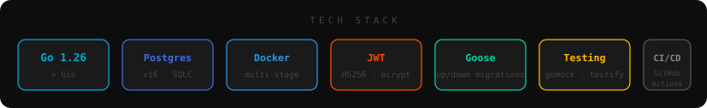

<div align="center">
  
  <h1>Bar 108 API</h1>
  <p><strong>Сервер заказов ресторана на Go</strong></p>
  <p>
    <a href="https://github.com/bytepharaoh/Bar108/actions/workflows/ci.yml"></a>
    
    
    
    
    <a href="LICENSE"></a>
  </p>
  <p><a href="README.md">English</a> · <a href="README.ru.md">Русский</a></p>
</div>

Bar 108 — HTTP API на Go для заказов ресторана. В нём есть учётные записи клиентов, меню, заказы, история статусов, промокоды и административные операции. Репозиторий содержит сервер и конфигурацию развёртывания. Клиентского приложения, оплаты, приложения курьера и передачи геопозиции в реальном времени здесь нет. «Отслеживание» означает запрос сохранённой истории статусов по HTTP.

Проект можно запустить локально или через Docker Compose. Отдельный Compose файл служит отправной точкой для одного сервера. Успешный CI подтверждает сборку и прохождение проверок кода, но не подтверждает настройку конкретного сервера, расписания резервного копирования или получателя оповещений.

## Устройство проекта


```text
HTTP-клиент → обработчики Gin → сервисы → репозитории → PostgreSQL
                    │                             │
                    └── JWT                      Redis: отзыв токенов, лимиты, кэш
```

Обработчики разбирают запросы и проверяют принадлежность ресурсов. Сервисы проверяют бизнес-правила. Репозитории используют запросы, сгенерированные sqlc, и транзакции для составных операций. Goose применяет миграции при запуске приложения. PostgreSQL хранит основные данные учётных записей и заказов. При каждом авторизованном запросе сервер проверяет текущее состояние пользователя в PostgreSQL, поэтому блокировка аккаунта и изменение роли действуют со следующего запроса.

Основные компоненты: Go 1.26.11, Gin, PostgreSQL 16, Redis 7, sqlc, Goose, JWT и bcrypt, Docker Compose, Caddy, Prometheus и Alertmanager. Производственная конфигурация рассчитана на один сервер и не обеспечивает высокую доступность.

## Технологический стек



Redis используется для отзыва токенов, ограничения запросов и кэширования. Caddy завершает HTTPS-соединения, а Prometheus и Alertmanager отвечают за метрики и маршрутизацию оповещений. Эти эксплуатационные компоненты дополняют основной стек, показанный выше.

## Локальный запуск

Нужны Go 1.26.11 или новее, Docker с Compose и `make` для приведённых команд.

```bash
git clone https://github.com/bytepharaoh/Bar108.git
cd Bar108
cp .env.example .env
```

Измените `.env`: пароль базы и JWT ключ в примере предназначены для разработки. Сгенерировать новый ключ можно командой `openssl rand -hex 32`. Не добавляйте `.env` в Git.

```bash
make db-up       # запустить PostgreSQL и Redis
make run         # подключиться, применить миграции Goose и запустить API на порту 8080
```

В другом терминале проверьте `curl http://localhost:8080/ping`. `GET /ready` проверяет PostgreSQL и Redis и возвращает 503 при недоступности любого из них. Для запуска всех компонентов в контейнерах после создания `.env` выполните `docker compose up -d --build`, затем `docker compose logs -f app`. В конфигурации разработки порты базы и Redis привязаны к localhost. Команда `docker compose down` останавливает контейнеры и сохраняет именованные тома с данными.

Пример запросов:

```bash
curl -X POST http://localhost:8080/auth/register \
  -H 'Content-Type: application/json' \
  -d '{"name":"Ahmed","phone":"+79001234567","email":"you@example.com","password":"change-this-password"}'

# Скопируйте токен из ответа:
TOKEN='paste-token-here'
curl -X POST http://localhost:8080/orders \
  -H "Authorization: Bearer $TOKEN" \
  -H 'Content-Type: application/json' \
  -d '{"items":[{"menu_item_id":1,"quantity":2}]}'
```

ID пользователя берётся из токена. При создании новой базы миграция добавляет позиции меню с ID 1–5; если база уже существовала, сначала проверьте `GET /menu`.

## Аутентификация и обработка заказа


## Обзор API

Ответы приходят в JSON. Для защищённых маршрутов нужен заголовок `Authorization: Bearer <token>`. Клиенты видят свои профили и заказы; администраторы управляют данными ресторана. Публичного способа зарегистрировать администратора нет: первую роль администратора необходимо выдать через контролируемую операцию с базой данных.

| Доступ | Методы и маршруты | Назначение |
| --- | --- | --- |
| Публичный | `GET /ping`, `GET /menu`, `GET /menu/:id`, `GET /categories` | Проверка процесса и чтение меню |
| Публичный | `POST /auth/register`, `POST /auth/login` | Регистрация и вход; лимит запросов по IP |
| Авторизованный | `POST /auth/logout` | Отзыв текущего токена в Redis |
| Авторизованный | `POST /orders`, `GET /orders/:id`, `GET /orders/:id/items`, `GET /orders/:id/track`, `PATCH /orders/:id/cancel` | Создание, просмотр, история и отмена своего заказа |
| Авторизованный | `GET /users/:id`, `PUT /users/:id`, `GET /users/:id/orders` | Свой профиль и история заказов; администратор может просматривать других пользователей |
| Администратор | `GET /orders`, `GET /orders/pending`, `PATCH /orders/:id/status`, `PATCH /orders/:id/courier` | Управление заказами |
| Администратор | `POST /menu`, `PUT /menu/:id`, `DELETE /menu/:id` | Управление меню |
| Администратор | `GET /users`, `GET /users/active`, `PATCH /users/:id/activate`, `PATCH /users/:id/deactivate`, `PATCH /users/:id/bonus` | Управление аккаунтами и ручная корректировка баллов |
| Администратор | `GET /couriers`, `GET /couriers/available`, `GET /couriers/:id`, `PATCH /couriers/:id/status` | Курьеры и их доступность |
| Внутренний | `GET /ready`, `GET /metrics` | Готовность зависимостей и метрики; публичный Caddy блокирует эти пути |

Статусы заказа: `pending → confirmed → preparing → ready → out_for_delivery → delivered`. До конечного статуса возможна отмена. SQL ограничивает переходы, поэтому два конкурирующих обновления не могут одновременно применить один переход. Стоимость рассчитывается десятичной арифметикой по сохранённым ценам меню; цена позиции копируется в заказ. Для промокодов проверяются срок и лимит использования. Баллы сейчас изменяются вручную администратором; автоматическое начисление и списание не реализованы.

## Разработка и тесты

```bash
go test -race -timeout 60s ./...
go vet ./...
make lint           # нужен golangci-lint
make sqlc           # нужен sqlc, только при изменении SQL-запросов
```

Тесты обработчиков и сервисов используют моки. Интеграционный тест репозитория запускается с PostgreSQL при установленной переменной `BAR108_TEST_DATABASE_URL`; CI задаёт её, запускает race detector, собирает бинарный файл и образ Docker, а также проверяет конфигурацию развёртывания. Без переменной интеграционный тест пропускается. Изменяйте SQL в `db/queries`, затем пересоздавайте `internal/db` через sqlc; сгенерированный Go код не является первоисточником.

## Развёртывание на одном сервере

`compose.production.yml` запускает API, PostgreSQL, Redis, Caddy, Prometheus и Alertmanager. Наружу открыты HTTP/HTTPS порты Caddy и Prometheus только на `127.0.0.1:9090`. Направьте DNS домена на сервер и откройте TCP 80/443 (и UDP 443 для HTTP/3). При доступном DNS и портах Caddy получает и обновляет TLS сертификаты. Защитите доступ к Docker socket, файлам секретов и резервным копиям.

```bash
cp .env.production.example .env.production
# Укажите BAR108_DOMAIN, DB_USER и DB_NAME в .env.production.
mkdir -p secrets
openssl rand -hex 32 > secrets/db_password
openssl rand -hex 32 > secrets/jwt_secret
# Укажите действующий URL, принимающий JSON от Alertmanager:
printf '%s\n' 'https://your-alert-receiver.example/alerts' > secrets/alert_webhook_url
chmod 600 secrets/* .env.production
docker compose --env-file .env.production -f compose.production.yml up -d --build
```

Пример URL для оповещений не отправит уведомления: нужен реальный получатель. Prometheus проверяет доступность API и повторяющиеся ошибки сервера. Его локальный интерфейс можно открыть через SSH туннель. Для обнаружения отказа всего сервера добавьте внешнюю проверку доступности: сервисы на том же сервере не смогут отправить сигнал, когда он недоступен.

Goose применяет новые миграции при запуске API. Сделайте резервную копию перед обновлением, особенно если миграция меняет данные. Скрипты создают архив PostgreSQL и проверяют его восстановлением во временную базу:

```bash
scripts/backup.sh
scripts/verify-backup.sh backups/bar108-YYYYMMDDTHHMMSSZ.dump
```

Настройте расписание скриптов на сервере, копирование архивов на отдельное хранилище, срок хранения и периодическую проверку восстановления. Скрипты сами не создают расписание и удалённое хранилище. Не добавляйте `.env.production`, `secrets/` и `backups/` в Git. Дополнительные шаги выпуска и восстановления: [операционная инструкция](docs/OPERATIONS.md) (на английском).

## Границы реализации

В API нет обработки платежей, передачи местоположения курьера, автоматических правил бонусной программы и сквозных тестов клиентского приложения. В примерной конфигурации PostgreSQL и Redis запущены по одному экземпляру. Redis необходим для защищённых запросов и выхода; при его отказе проверка готовности не проходит, а защищённые запросы отклоняются. До обработки реальных данных клиентов определите сроки хранения, требования к персональным данным, шифрование резервных копий и порядок выдачи первой роли администратора.

## Участие в проекте

Проект открыт для сотрудничества. Исправления ошибок, тесты, улучшения документации и небольшие функциональные изменения приветствуются — сделайте fork репозитория и откройте pull request. Для крупного изменения поведения сначала создайте issue, чтобы заранее согласовать решение и границы работы. Делайте pull request сфокусированным, описывайте влияние на пользователей и эксплуатацию, обновляйте сгенерированный sqlc-код при изменении SQL и убедитесь, что CI проходит.

## Лицензия

Проект распространяется по [лицензии MIT](LICENSE), copyright © 2026 bytepharaoh. Она разрешает использование, изменение и распространение при сохранении уведомлений об авторском праве и разрешении; программное обеспечение предоставляется без гарантий. У сторонних зависимостей собственные лицензии.
